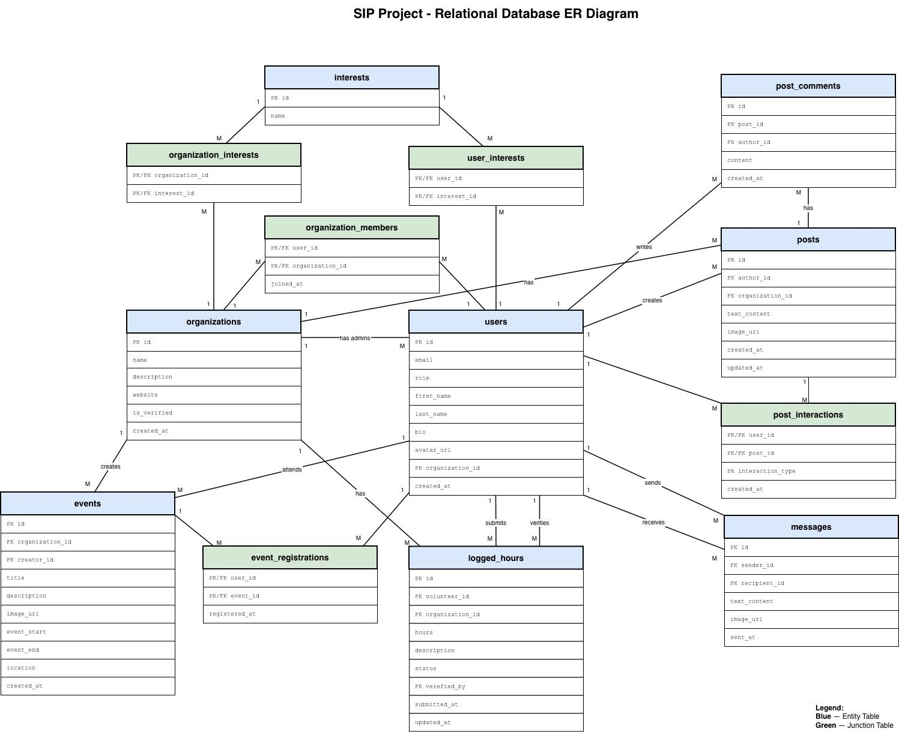

# Approved relational data model

Source: [Detailed Design Document](../Detailed%20Design%20Doc.pdf), Figure 4 (p. 11) and Figures 5–17 (pp. 12–18), visually checked against the extracted text. This is a transcription, not SQL or a migration.

## Relationship diagram

[Open the full-resolution diagram](design/assets/relational-database-erd.jpeg).

Source: Figure 4, Detailed Design Document p. 11. This original image was extracted directly from the supplied PDF and matches the diagram provided in chat. Blue tables are entity tables; green tables are junction tables. The column definitions below document the types, nullability, defaults and constraints from Figures 5–17. The diagram does not resolve the open constraints or authorization questions recorded in [development decisions](development-decisions.md).

## users

Profile data for all account types. Source: DDD p. 12.

| Column | PostgreSQL type | Nullable | Keys, defaults and constraints |
| --- | --- | --- | --- |
| id | UUID | No (PK) | PK; matches Supabase auth.users.id |
| email | VARCHAR(255) | No | UNIQUE |
| role | VARCHAR(20) | No | Permitted: STANDARD, ADMIN, ORGANIZATION |
| first_name | VARCHAR(100) | No | — |
| last_name | VARCHAR(100) | No | — |
| bio | TEXT | Yes | — |
| avatar_url | VARCHAR(255) | Yes | Profile image reference |
| organization_id | UUID | Yes | FK organizations(id) |
| created_at | TIMESTAMPTZ | No | Default NOW() |

Organization FK stores the account association; the PDF says ADMIN and ORGANIZATION accounts belong to exactly one organization despite nullable storage. Conditional enforcement is unresolved (D02). Auth UUID matching is specified; an explicit FK/deletion strategy to auth.users is not. Email/profile synchronization and public-field exposure require review.

## organizations

Nonprofit/volunteer organization entity. Source: DDD p. 13.

| Column | PostgreSQL type | Nullable | Keys, defaults and constraints |
| --- | --- | --- | --- |
| id | UUID | No (PK) | PK; default uuid_generate_v4() |
| name | VARCHAR(255) | No | — |
| description | TEXT | Yes | — |
| website | VARCHAR(255) | Yes | — |
| is_verified | BOOLEAN | No | Default FALSE; authenticity verification |
| created_at | TIMESTAMPTZ | No | Default NOW() |

No unique organization-name constraint is specified. Verification authority remains unresolved; ordinary profile editors must not self-verify.

## interests

Standardized interest/tag lookup. Source: DDD p. 13.

| Column | PostgreSQL type | Nullable | Keys, defaults and constraints |
| --- | --- | --- | --- |
| id | UUID | No (PK) | PK |
| name | VARCHAR(255) | No | UNIQUE |

Interest creation authority and seed taxonomy are unspecified; do not invent categories.

## user_interests

User interests for recommendations/filtering. Source: DDD p. 13.

| Column | PostgreSQL type | Nullable | Keys, defaults and constraints |
| --- | --- | --- | --- |
| user_id | UUID | No (PK) | PK part; FK users(id) |
| interest_id | UUID | No (PK) | PK part; FK interests(id) |

Composite PK (user_id, interest_id) prevents duplicate user/tag associations.

## organization_interests

Organization categories for recommendations/filtering. Source: DDD p. 14.

| Column | PostgreSQL type | Nullable | Keys, defaults and constraints |
| --- | --- | --- | --- |
| organization_id | UUID | No (PK) | PK part; FK organizations(id) |
| interest_id | UUID | No (PK) | PK part; FK interests(id) |

Composite PK (organization_id, interest_id) prevents duplicate organization/tag associations.

## organization_members

Volunteer membership in organizations/groups. Source: DDD p. 14.

| Column | PostgreSQL type | Nullable | Keys, defaults and constraints |
| --- | --- | --- | --- |
| user_id | UUID | No (PK) | PK part; FK users(id) |
| organization_id | UUID | No (PK) | PK part; FK organizations(id) |
| joined_at | TIMESTAMPTZ | No | Default NOW() |

Composite PK (user_id, organization_id). Membership is separate from users.organization_id and does not establish management authority; admission/leave rules are D11.

## posts

Community-feed text/image posts. Source: DDD p. 15.

| Column | PostgreSQL type | Nullable | Keys, defaults and constraints |
| --- | --- | --- | --- |
| id | UUID | No (PK) | PK |
| author_id | UUID | No | FK users(id) |
| organization_id | UUID | Yes | FK organizations(id); optional group-page association |
| text_content | TEXT | Yes | Either text or image must be present (application logic) |
| image_url | VARCHAR(255) | Yes | Either text or image must be present (application logic) |
| created_at | TIMESTAMPTZ | No | Default NOW() |
| updated_at | TIMESTAMPTZ | No | Tracks post edits; no default specified |

Both content fields may be populated; the design requires at least one, not exclusive-or. Blank-text semantics are proposed validation. Group-page authorization and edit timestamp behavior need confirmation.

## post_interactions

Likes and saves. Source: DDD p. 15.

| Column | PostgreSQL type | Nullable | Keys, defaults and constraints |
| --- | --- | --- | --- |
| user_id | UUID | No (PK) | PK part; FK users(id) |
| post_id | UUID | No (PK) | PK part; FK posts(id) |
| interaction_type | VARCHAR(20) | No (PK) | PK part; permitted LIKE, SAVE |
| created_at | TIMESTAMPTZ | No | Default NOW() |

Composite PK (user_id, post_id, interaction_type) allows a like and a save for the same post, while preventing duplicates of each. Saved items are private (DDD p. 7). No SHARE value exists.

## post_comments

Text-only post responses. Source: DDD p. 16.

| Column | PostgreSQL type | Nullable | Keys, defaults and constraints |
| --- | --- | --- | --- |
| id | UUID | No (PK) | PK |
| post_id | UUID | No | FK posts(id) |
| author_id | UUID | No | FK users(id) |
| content | TEXT | No | — |
| created_at | TIMESTAMPTZ | No | Default NOW() |

No nested-comment or image-comment column exists. Nonblank content and maximum text size need confirmation.

## events

Organization-created volunteer opportunities. Source: DDD p. 16.

| Column | PostgreSQL type | Nullable | Keys, defaults and constraints |
| --- | --- | --- | --- |
| id | UUID | No (PK) | PK |
| organization_id | UUID | No | FK organizations(id) |
| creator_id | UUID | No | FK users(id); tracks creating admin |
| title | VARCHAR(255) | No | — |
| description | TEXT | No | — |
| image_url | VARCHAR(255) | Yes | — |
| event_start | TIMESTAMPTZ | No | — |
| event_end | TIMESTAMPTZ | No | — |
| location | VARCHAR(255) | No | — |
| created_at | TIMESTAMPTZ | No | Default NOW() |

Organization account event management is described on p. 19 while creator_id describes an admin; clarify roles (D02). End-after-start validation is PROPOSED. No capacity, status, event-interest junction or recurrence fields exist.

## event_registrations

Volunteer RSVPs. Source: DDD p. 17.

| Column | PostgreSQL type | Nullable | Keys, defaults and constraints |
| --- | --- | --- | --- |
| user_id | UUID | No (PK) | PK part; FK users(id) |
| event_id | UUID | No (PK) | PK part; FK events(id) |
| registered_at | TIMESTAMPTZ | No | Default NOW() |

Composite PK (user_id, event_id). No registration status or attendance field. Cancellation/past-event rules are D11.

## logged_hours

Manual hours submitted for organization verification. Source: DDD p. 17.

| Column | PostgreSQL type | Nullable | Keys, defaults and constraints |
| --- | --- | --- | --- |
| id | UUID | No (PK) | PK |
| volunteer_id | UUID | No | FK users(id) |
| organization_id | UUID | No | FK organizations(id); determines approver organization |
| hours | NUMERIC(5,2) | No | — |
| description | TEXT | Yes | — |
| status | VARCHAR(20) | No | Default PENDING; permitted PENDING, APPROVED, DENIED |
| verified_by | UUID | Yes | FK users(id) |
| submitted_at | TIMESTAMPTZ | No | Default NOW() |
| updated_at | TIMESTAMPTZ | No | Approval/denial timestamp; no default specified |

NUMERIC(5,2) supports up to three integer digits and two fractional digits; a positive-only constraint is not specified. Review identity must be authorized for organization. No event/date/evidence field exists. Review transitions and consistency rules are D10.

## messages

Basic direct messages. Source: DDD p. 18.

| Column | PostgreSQL type | Nullable | Keys, defaults and constraints |
| --- | --- | --- | --- |
| id | UUID | No (PK) | PK |
| sender_id | UUID | No | FK users(id) |
| recipient_id | UUID | No | FK users(id) |
| text_content | TEXT | Yes | Either text or image must be present (application logic) |
| image_url | VARCHAR(255) | Yes | Either text or image must be present (application logic) |
| sent_at | TIMESTAMPTZ | No | Default NOW() |

At least one content type; both allowed. Participant privacy is required; no read-state, thread or attachment table exists. Recipient restrictions and retention are unresolved.

## Validation boundary

Approved application rules: posts/messages require text and/or image; references must identify valid related records; enum values and VARCHAR/NUMERIC bounds must be respected; writes must enforce ownership and organizational authority. **PROPOSED for team review:** trim and reject blank required text, validate email/HTTPS URLs, require positive hours, reject event_end at/before event_start, derive identity fields server-side and control timestamp updates. The design does not establish text limits for TEXT fields, email normalization, row deletion behavior or audit retention. Confirm these before dependent implementation.
